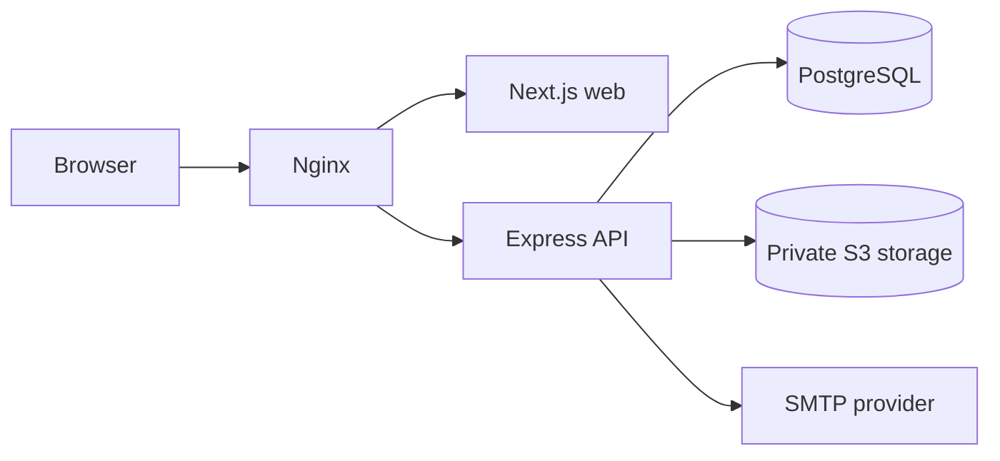
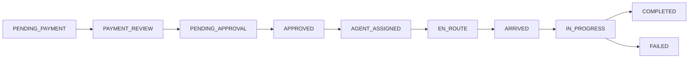

# Architecture

QueueMate is a TypeScript monorepo with three runtime boundaries: a Next.js web application, an Express REST API, and PostgreSQL plus private S3-compatible storage. Nginx exposes the web app and `/api/` on one origin, which keeps cookie sessions simple and prevents browsers from contacting infrastructure directly.

`apps/web` contains public and role-specific routes. `apps/api` owns authentication, authorization, business rules, persistence, and file access. `packages/shared` contains cross-boundary contracts and status-transition rules. `prisma` contains the schema, migration history, and development seed.

The core request state is deliberately separate from payment and assignment state. A payment must be manually verified before request approval; an approved request must pass availability and collision checks before assignment; only the assigned agent can update its field status.

