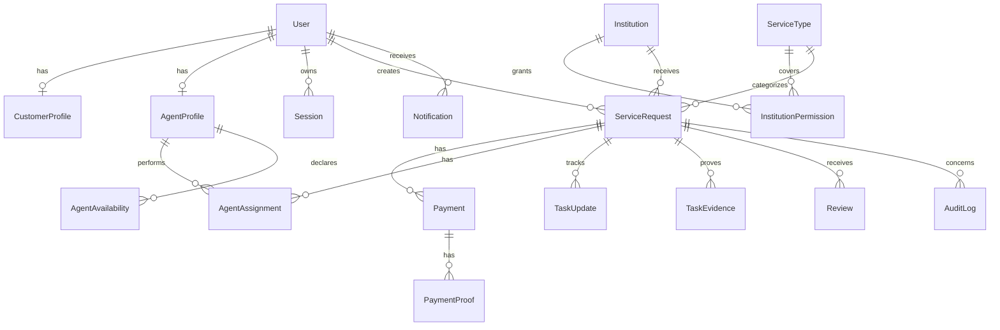

# Data model

Monetary values use PostgreSQL decimal columns and timestamps are stored as UTC. The business timezone is `Africa/Gaborone` when translating customer dates/times. Soft deletion is used for institutions and service requests; audit events remain append-only.
